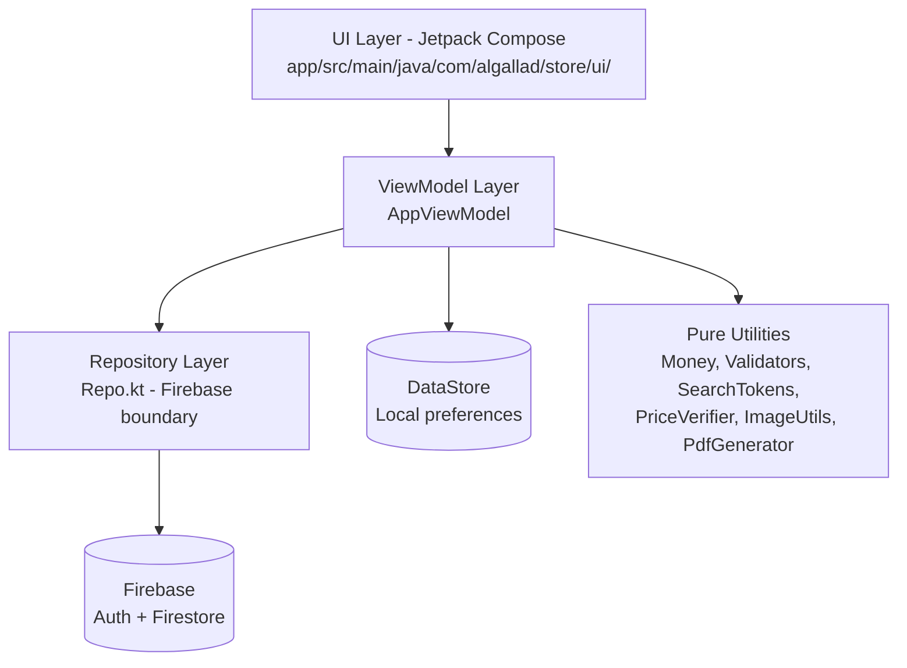

# AlGallad

**Bilingual Arabic RTL / English Android store app** for a trading company in Egypt. Cash on delivery (COD), customer accounts, product catalog in Cloud Firestore, PDF order invoices sent to the seller via WhatsApp.

> Source published for portfolio viewing. All rights reserved.

[](https://kotlinlang.org/)
[](https://developer.android.com/compose)
[](https://firebase.google.com/)
[](https://developer.android.com/)
[](https://github.com/ahmed62001/AlGallad/actions/workflows/android.yml)

---

## Pitch

Al-Gallad Trading Establishment needed a mobile storefront where customers can browse products in Arabic or English, place cash-on-delivery orders, and receive a bilingual PDF invoice that they can forward to the seller through WhatsApp. The app is built for Firebase's free Spark tier: product images are Base64-encoded WebP thumbnails embedded in Firestore documents, prices are stored as integer piastres to avoid floating-point drift, and admin actions are gated both client-side and by Firestore Security Rules.

---

## Highlights

All engineering points below are verified against the source code under `app/src/main/java/com/algallad/store/`:

1. **Bilingual RTL/LTR UI** — Arabic and English string resources (`app/src/main/res/values/` and `values-ar/`), runtime language switching via `androidx.appcompat.app.AppCompatDelegate.setApplicationLocales`, and `android:supportsRtl="true"` in the manifest.
2. **Firebase Auth with email verification** — Email/password authentication, email-verification gating on order creation, and a verification dialog after registration (`AuthScreen.kt`, `AppViewModel.kt`, `MainActivity.kt`).
3. **Firestore Security Rules with admin allowlist** — Rules at `firebase/firestore.rules` enforce authenticated customer ownership of profiles/orders and restrict product/order mutations to an admin email allowlist (`admin@example.com` placeholder).
4. **Prices stored as integer piastres** — All money is handled as whole piastres (1 EGP = 100 piastres) to avoid floating-point errors (`Money.kt`, `Models.kt` `priceMinor` fields).
5. **Base64 WebP image pipeline on Spark-tier budgets** — Images are decoded with EXIF rotation, resized, encoded as WebP, Base64-encoded, and size-capped per document (thumb ≤ 15 KB, full images ≤ ~120 KB) to stay within Firestore limits (`ImageUtils.kt`, `Components.kt` `ImageCache`).
6. **DataStore for local-only preferences** — Theme mode (System/Light/Dark), font scale, and language are persisted with AndroidX DataStore; nothing leaves the device (`ThemePrefs.kt`, `ProfileScreen.kt`).
7. **Offline-friendly image cache** — In-memory LRU plus disk cache keyed by `productId_imgVersion_index` for Base64 product images (`Components.kt` `ImageCache`).

---

## Architecture

The app follows a layered, unidirectional data flow:



**Layers:**
- **UI** (`ui/`) — Compose screens, navigation, theming, brand tokens, image cache, PDF/WhatsApp sharing.
- **ViewModel** (`AppViewModel.kt`) — UI state, cart, orders, products, auth session, checkout orchestration.
- **Repository** (`data/Repo.kt`) — Firebase Auth and Firestore boundary; wraps all cloud reads/writes.
- **Firebase** — Authentication (email/password) and Cloud Firestore (products, orders, users, settings).
- **DataStore** — Local-only theme, font scale, and language preferences.
- **Pure utilities** (`data/`, `util/`) — Money formatting, phone/email validation, search-token generation, price verification, PDF generation, image compression — all unit-testable without Android or Firebase.

---

## Project structure

```
AlGallad/
├── app/
│   ├── build.gradle.kts              # Module build config, signing, buildConfig fields
│   ├── google-services.json.example  # Fake Firebase client config structure (placeholders only)
│   ├── proguard-rules.pro
│   ├── src/
│   │   ├── main/
│   │   │   ├── java/com/algallad/store/
│   │   │   │   ├── AlGalladApp.kt       # Application class, AppCheck setup
│   │   │   │   ├── AppViewModel.kt      # UI state + checkout orchestration
│   │   │   │   ├── MainActivity.kt      # Entry point, theme/font-scale pre-read
│   │   │   │   ├── data/                # Models, Repo, Validators, Money, SearchTokens,
│   │   │   │   │   │                     ThemePrefs, PriceVerifier, AuthErrors
│   │   │   │   ├── ui/                  # Compose screens, theme, components, navigation
│   │   │   │   └── util/                # PdfGenerator, WhatsAppSender, ImageUtils, Util
│   │   │   ├── res/                     # Values, values-ar, drawable, mipmap, font, xml
│   │   │   └── AndroidManifest.xml
│   │   ├── debug/                       # Debug AppCheck provider
│   │   └── release/                     # Release AppCheck provider
│   └── src/test/                      # JVM unit tests for pure logic
├── build.gradle.kts                   # Root build plugins
├── firebase/
│   ├── firestore.rules                # Firestore Security Rules
│   └── firestore.indexes.json         # Composite index definitions
├── gradle/
│   ├── libs.versions.toml             # Version catalog
│   └── wrapper/                       # Gradle wrapper
├── gradle.properties
├── settings.gradle.kts
├── gradlew / gradlew.bat
└── README.md
```

---

## Tech stack

| Layer | Technology |
|-------|-----------|
| Language | Kotlin 2.4.20 |
| UI | Jetpack Compose, Material 3 |
| Navigation | Navigation Compose |
| Local storage | AndroidX DataStore (Preferences) |
| Images | ExifInterface, Base64 WebP pipeline |
| Backend | Firebase Authentication, Cloud Firestore |
| App integrity | Firebase App Check + Play Integrity |
| Build | Gradle 9.6, AGP 9.4, Kotlin Compose plugin |
| minSdk / targetSdk | 26 / 36 |

---

## Setup

This repository deliberately contains **no secrets, API keys, signing files, Firebase project configuration, customer data, product data, or real contact details**. All values are placeholders.

1. **Create a Firebase project** — Enable Email/Password Authentication and Cloud Firestore in the Firebase Console (Spark/free plan is sufficient).
2. **Add Android config** — Download your project's `google-services.json` and save it locally as `app/google-services.json`. Use `app/google-services.json.example` only as a structural reference; it contains placeholders and must never be committed with real values.
3. **Set your admin email** — Update `app/build.gradle.kts` (`ADMIN_EMAILS` buildConfig field) and `firebase/firestore.rules` (`isAdmin()` allowlist) with your own admin email.
4. **Set your seller WhatsApp number** — Configured through the app's admin store-settings screen at runtime and stored in Firestore (`settings` document).
5. **Deploy Firestore rules/indexes** — Optionally deploy `firebase/firestore.rules` and `firebase/firestore.indexes.json` via the Firebase CLI.
6. **Build a debug APK:**

   ```bash
   ./gradlew assembleDebug
   ```

For release distribution, configure signing only in your local environment (`keystore.properties` is git-ignored). Do not commit signing files or credentials.

---

## Roadmap / ideas (not implemented)

The following are portfolio ideas only and are **not** present in the code:

- Product ratings and reviews
- Push notifications for order status changes
- Online payment integration (the app is cash-on-delivery only)
- Multi-store / multi-vendor support
- Order history export

---

## Images

Screenshots are omitted intentionally to avoid exposing real accounts or customer data.

---

> Source published for portfolio viewing. All rights reserved.
8. **Guest browsing with optional sign-in** — Shoppers can browse products and cart without an account; sign-in is required only to place an order (`AppRoot.kt`, `AuthDefaults.kt`).
9. **Price re-verification before checkout** — Customer-side fresh price check against Firestore and admin-side re-verification with mismatch flags (`PriceVerifier.kt`, `AppViewModel.kt`).
