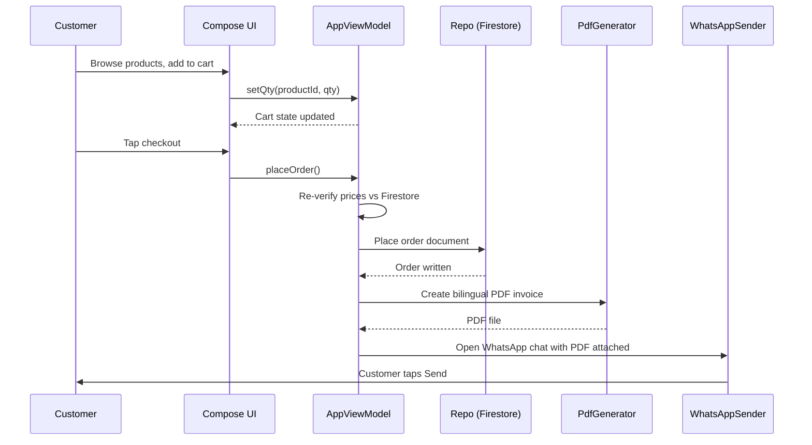

# Architecture

AlGallad is a single-module Android application written in Kotlin with Jetpack Compose. All code lives under `app/src/main/java/com/algallad/store/`.

## Package structure

```
com.algallad.store
├── AlGalladApp.kt          # Application class, Firebase AppCheck initialization
├── AppViewModel.kt          # UI state, cart, orders, checkout orchestration
├── MainActivity.kt          # Entry point, theme/font-scale pre-read, edge-to-edge
├── data/
│   ├── AuthDefaults.kt      # Guest/login default mode
│   ├── AuthErrors.kt        # Auth error mapping (pure, JVM-testable)
│   ├── DefectFixLogic.kt    # Pure helpers for verified defect fixes
│   ├── Models.kt            # Firestore data models (Product, Order, UserProfile, etc.)
│   ├── Money.kt             # Piastre-based money formatting and parsing
│   ├── PriceVerifier.kt     # Order price re-verification logic
│   ├── Repo.kt              # Firebase Auth/Firestore boundary
│   ├── SearchTokens.kt      # Arabic-aware search token generation
│   ├── ThemePrefs.kt        # DataStore theme/font-scale preferences
│   └── Validators.kt        # Phone, email, password validation
├── ui/
│   ├── AppRoot.kt           # Navigation host, tabs, theming
│   ├── AuthScreen.kt        # Login/register UI, email verification dialog
│   ├── AppCheckSetup.kt     # (debug/release source sets) Firebase AppCheck provider
│   ├── Components.kt        # Reusable Compose components, ImageCache
│   ├── OrdersScreen.kt      # Customer and admin order screens
│   ├── ProfileScreen.kt     # Profile, theme, font scale, account deletion
│   ├── ShopScreens.kt       # Product catalog, product detail, cart, checkout
│   └── theme/               # Material3 theme, brand colors, typography
└── util/
    ├── ImageUtils.kt        # Base64 WebP image pipeline with size budgets
    ├── PdfGenerator.kt      # Bilingual PDF order invoice
    ├── Util.kt              # Date/money/number formatting helpers
    └── WhatsAppSender.kt    # WhatsApp PDF sharing
```

## Data flow

### Browse → Cart → Checkout → Order → PDF → WhatsApp



### Admin flow

```mermaid
graph TD
    Admin[Admin User] --> UI[Admin Compose Screens]
    UI --> VM[AppViewModel admin methods]
    VM --> REPO[Repo Firestore writes]
    REPO --> Rules[Firestore Security Rules]
    Rules -->|allow only if isAdmin()| FB[(Firestore)]
    Rules -->|deny otherwise| FB
```

## Key design points

- **Pure utilities** — Money formatting, validators, search tokens, price verification, and defect-fix logic contain no Android or Firebase references, so they are unit-testable on the JVM.
- **Repository boundary** — All Firebase access goes through `Repo.kt`; the ViewModel never calls Firebase directly.
- **Security rules as source of truth** — `firebase/firestore.rules` enforces the same access control the client expects (admin allowlist, customer ownership, order immutability after creation except cancellation).
- **DataStore** — Theme mode, font scale, and language are stored locally only; nothing is synced to the server.
